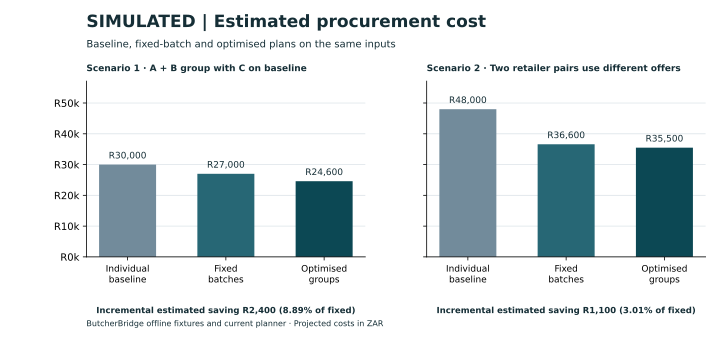

# Impact, KPIs and evidence

## Before and after procurement cost

The figures below are **SIMULATED estimated costs in ZAR**. Each row compares alternatives on the same committed orders, tiers, capacity, holds and evaluation date. They are outputs of the production functions used by the application. Run `python -B final_app/demo_comparison.py` from the repository root to reproduce the plan, exact amounts, order IDs and assigned shares offline.

| Scenario | Individual baseline B | Fixed batches F | Optimised groups O | Fixed saving B−F | Optimised saving B−O | Incremental saving F−O |
|---|---:|---:|---:|---:|---:|---:|
| 1. Two retailers group and one keeps its baseline | R30,000.00 | R27,000.00 | R24,600.00 | R3,000.00 (10.00% of B) | R5,400.00 (18.00% of B) | **R2,400.00 (8.89% of F)** |
| 2. Two retailer pairs buy from different offers | R48,000.00 | R36,600.00 | R35,500.00 | R11,400.00 (23.75% of B) | R12,500.00 (26.04% of B) | **R1,100.00 (3.01% of F)** |

**Figure 1.** Simulated estimated procurement costs, with the same scale in both panels. Within each panel the first bar is the individual baseline and the next two are the alternative plans for the same inputs. Incremental percentages use the fixed plan as denominator. The [chart source](../scripts/generate_impact_chart.py) calls the same planner as the [offline demo](../demo_comparison.py).

### How the figures reconcile

- The individual baseline is the sum of ordered kg × individual R/kg plus recorded individual logistics cost. A plan counts each committed order once. It uses a selected delivered quote or the full baseline for retained orders.
- Delivered quote cost equals kg × highest qualifying all-units tier price plus fixed delivery, kg × variable delivery charge and handling. The quote is rounded to cents. Separate purchases use separate charges and tiers even if their hold quantities are summed for one offer/window.
- Fixed and optimised percentages are `100 × (B−F)/B` and `100 × (B−O)/B`. Incremental is `100 × (F−O)/F`. The comparison uses Decimal totals before display rounding. Percentage outputs round half-up to two decimal places. A zero denominator returns null or a dash in the interface.
- Scenario 1 uses 300 kg available after a 50 kg hold. The fixed batch buys 300 kg. The optimised plan spends R18,600 on 200 kg for A and B and R6,000 on C's retained baseline. Scenario 2 uses 200 kg on each of two offers, costing R16,500 and R19,000. The first offer can supply only 200 kg after prior holds, so the whole 400 kg fixed batch uses the second offer.

### Retailer participation and fairness

| Scenario and retailer group | Individual cost per retailer | Fixed cost per retailer | Optimised cost per retailer | Optimised saving per retailer vs baseline |
|---|---:|---:|---:|---:|
| 1, A and B each | R12,000 | R10,800 | R9,300 | R2,700 |
| 1, C | R6,000 | R5,400 | R6,000 | R0 |
| 2, A and B each | R12,000 | R9,150 | R8,250 | R3,750 |
| 2, C and D each | R12,000 | R9,150 | R9,500 | R2,500 |

Each selected quote must cost less than the combined baseline and be recoverable within the sum of the retailers' whole-cent baseline caps. Shares reconcile to the quote in cents and stay within each cap. Retailer C in scenario 1 and C and D in scenario 2 save less under optimised grouping than under fixed batches. Participation decisions should explain this distribution alongside the overall saving. Reliable baseline and quote evidence matters because reported baseline values affect the suggested shares.

## Recorded fulfilment KPIs

The dashboard and `GET /api/kpis` calculate actual fulfilment ratios from persisted records. The local integration verification recorded one **simulated** fulfilment for 95 of 100 kg, completed in two days against two planned days.

| KPI | Calculation | Before recording | After recording the test delivery |
|---|---|---:|---:|
| Fill rate | Total delivered kg / total ordered kg among joined fulfilments | Unavailable (no ordered denominator) | 95.0% |
| On time | Count with actual days ≤ planned days / number of recorded fulfilments | Unavailable (n=0) | 100.0% |
| Strict OTIF | Count on time and with delivered kg ≥ ordered kg / number of recorded fulfilments | Unavailable (n=0) | 0.0% |
| Committed demand | Sum kg of committed orders | Includes the 100 kg example | Falls by 100 kg when the order becomes fulfilled |

This is evidence of end-to-end recording and recalculation. The sample size is one fictional delivery. It cannot support a client performance comparison. Quoted and actual costs exist in the fulfilment table. The current KPI response does not compute actual cost variance or trend periods. Future evaluation should record comparable time periods, sample counts, baseline quantities and actual paid delivered costs using a consented dataset. See [workflow verification](END_TO_END_WORKFLOWS.md) and the [primary-data protocol](PRIMARY_DATA_COLLECTION.md).

## Sustainability, evidence and limitations

Tag data as primary, quoted, estimated or simulated with a date and source reference. Obtain consent before using client records. Use dated quotations or invoices for commercial inputs and anonymise report figures where required. Validate that suppliers will honour separate purchase tiers and fixed charges and confirm capacity, availability and constraints for the relevant date. Record the status of bookings, withdrawals and fulfilments separately. A planner proposal leaves the database unchanged, and a released reservation still occupies its unique offer/window key.

Trip count and route distance fields are descriptive. Baseline logistics costs are supplied values. Offer capacity describes available product, and vehicle loads, routing, refrigeration, fuel and emissions are outside the model. To test a possible sustainability gain, collect dispatch records for one comparable lane. Report kg delivered, distance, actual trip count, load and fuel with the period and measurement method. Apply a sourced emissions factor only if measured inputs and comparable scope are available. This submission has no measured distance, fuel, emissions or realised financial reduction.

## Practical scaling limits

- Compatibility partitions demand by product/specification ID, window, needed date and area. Offer capacity is still shared across windows. Split future workload only on genuinely independent capacity pools, or retain joint checks.
- A bucket with eight retailer bundles can have 255 nonempty subsets before offers are considered. Optimised search is bounded by 8 retailers per bucket, 5,000 quote evaluations and 100,000 search nodes across the request by default. It retries fixed planning independently on a limit.
- Fixed planning uses the sum of individual minima when jointly feasible. Otherwise its 100,000-combination cap includes a baseline branch per contested batch. With two choices per batch, 17 conflicting batches can exceed that cap. Limit fallback retains baselines. Fallback differences describe the returned plans.
- The order API has offset pagination, but the dashboard loads planning inputs and solves both modes per request. Before attempting regional rollout, record latency, fallback frequency and peak memory with increasing buckets and active offers. Verify demand/offer index use with `EXPLAIN` on synthetic scale data. Preserve the snapshot, reservation and exact monetary rules if considering independently partitioned work or reproducible cached read results.
- Provision per-user access, request limits and operating telemetry before widening use. Evaluate multi-area supplier support, shipment consolidation and historical KPI windows against verified process requirements and data.
